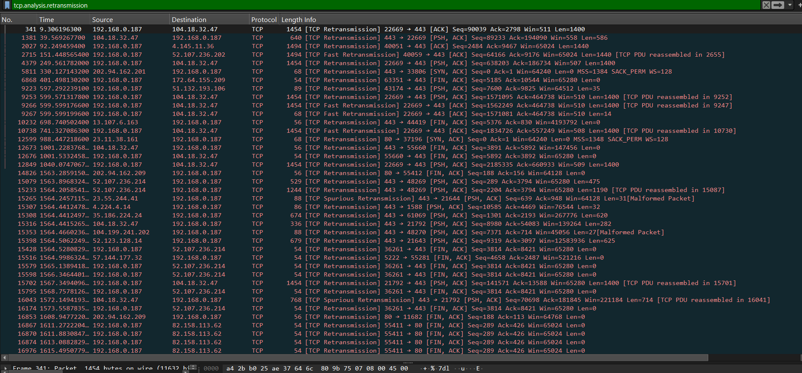
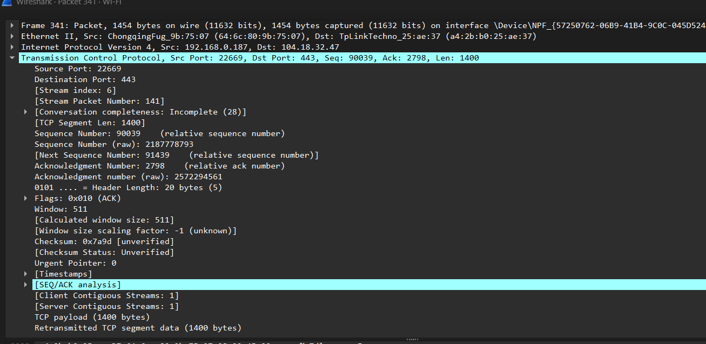
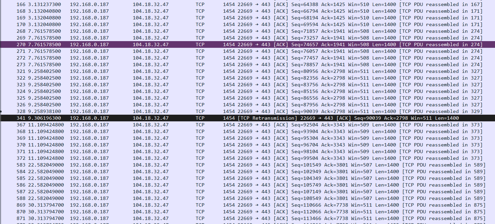

# SOC Lab 001 — Network Traffic Investigation with Wireshark

**Type:** Supervised, hands-on cybersecurity training lab using traffic captured from my own laptop  
**Date:** 27 October 2026  
**Tool:** Wireshark 4.6.9  
**Focus:** DNS, TCP, TLS, retransmissions, and evidence-based SOC reporting

## Objective

Investigate observed outbound network traffic, establish whether a TCP connection succeeded, identify an indicated hostname from TLS metadata, and assess what the available evidence does—and does not—prove. A simulated SOC alert was used as the reporting scenario; **this was not a confirmed attack or an organizational incident**.

## Lab environment

- Windows laptop on Wi-Fi; private client IP observed: `192.168.0.187`
- Approximately **19,123 packets** captured
- Display filters used: `dns`, `tcp.flags.syn == 1 && tcp.flags.ack == 0`, `tcp.stream eq 11`, `tcp.analysis.retransmission`, `frame.number == 341`, and `tcp.stream eq 6`
- Packet numbers are specific to this capture and are not fixed TCP protocol values.

## Investigation 1 — DNS query and response

A DNS query in **frame 405** originated from `192.168.0.187:49665` to resolver `192.168.0.1:53`, requesting an **HTTPS (type 65)** DNS record for `www.bing.com`. The response in **frame 407** matched transaction ID `0xdc7e`, returned **No error**, and contained three CNAME answers:

`www.bing.com` → `www-www.bing.com.trafficmanager.net` → `www.bing.com.edgekey.net` → `e86303.dscx.akamaiedge.net`

The observed DNS response time was approximately **0.4592 ms**. This response did **not** establish that a person visited the website, nor did its three CNAME answers themselves provide an IPv4 A record.

## Investigation 2 — TCP connection establishment and TLS

A TCP conversation (`tcp.stream eq 11`) was observed from `192.168.0.187:40040` to `57.144.177.32:443`.

| Frame | Evidence | Interpretation |
| --- | --- | --- |
| 236 | SYN | Client requested TCP connection |
| 238 | SYN-ACK | Remote endpoint responded |
| 240 | ACK | TCP three-way handshake completed |
| 244 | TLS Client Hello, SNI `web.whatsapp.com` | Client indicated the requested hostname |
| 253 | TLS 1.3 Server Hello | TLS handshake progressed |
| 254 onward | Encrypted application data | Encrypted data exchange observed |
| 351–354 | FIN/ACK exchange | Orderly TCP shutdown observed |

**Assessment:** The TCP connection was established and encrypted traffic was exchanged. SNI identifies a hostname indicated by the client; it does **not** prove that the user manually visited WhatsApp Web, sent messages, or performed any specific action. The capture alone does not confirm maliciousness or authorization.

## Investigation 3 — TCP retransmission

The filter `tcp.analysis.retransmission` identified retransmission-related packets. In `tcp.stream eq 6`, frames **328** and **341** were observed from `192.168.0.187:22669` to `104.18.32.47:443` with the same TCP sequence number **90039** and TCP payload length **1400 bytes**. Frame 341 was labeled a retransmission, approximately **47.3 ms** after frame 328.

This supports that the same TCP sequence range was transmitted again. **The root cause was not established**: packet loss, acknowledgment timing, reordering, or capture artifacts may contribute. A retransmission alone is not proof of an attack or complete connection failure.

### Screenshots

The included screenshots document the retransmission filter, TCP stream index, and stream 6 packet analysis:

## SOC assessment and next steps

**Finding:** Network communications were observed, including a successfully established TCP/TLS session associated with the SNI `web.whatsapp.com`, and a separate TCP retransmission. **No malicious activity was confirmed from the available evidence.**

To determine whether the observed connection was authorized, I would correlate endpoint process execution and network connection logs, browser history, SIEM/EDR alerts, and the organization's acceptable-use policy. I would not close a real security alert solely because a hostname appears familiar.

## Skills demonstrated

- Wireshark capture and display filtering
- DNS queries, responses, CNAMEs, and transaction matching
- TCP flags, streams, and three-way handshake verification
- TLS Client Hello and SNI inspection
- TCP sequence numbers and retransmission analysis
- Distinguishing observed facts from unproven assumptions
- Structured SOC investigation reporting

## Scope and limitations

This was a supervised learning exercise with traffic from my own device. The alert scenario was simulated; no malware, data theft, policy violation, or actual compromise was established. No packet capture (`.pcapng`) is distributed here to avoid unintentionally exposing private browsing or network metadata. The screenshots should be reviewed for personal information before public publication.

## Assessment

Completed a five-question conceptual final assessment with a score of **10/10** (passing threshold **8/10**). This is a training assessment, not a professional certification.
